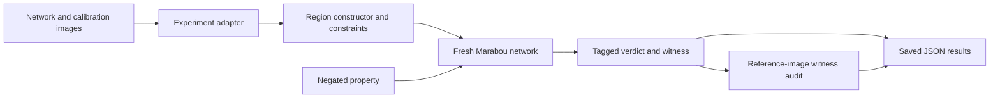

# Software design

## Separation of responsibilities

The reusable module describes regions and queries independently of a specific image dataset. Experiment scripts supply the network, preprocessing, reference images, property, and calibration choices. This lets the same region-based workflow be applied to several models while keeping each experiment's assumptions explicit.

## Core interfaces

`Region` stores a tag, parameters, and an `attach(net, ivars)` operation. Its constructors implement pixel boxes, perturbation balls, decoder regions, local PCA regions, and neighbor boxes. `Constraint` objects add intensity, variation, frequency, or photometric conditions. `intersect` combines a base region with selected constraints.

`run_query(make_net, region, postcondition, timeout_s)` creates a network, attaches the region and negated property, and invokes Marabou. Keeping the region parameters with the verdict makes the scope of a proof inspectable. A SAT result supplies a violating assignment; an UNSAT result rules out that negated property within the encoded region. A timeout remains unresolved.

`WitnessAudit` compares a returned image with reference data using nearest-image distance, adjacent-pixel statistics, and an optional classifier. The audit helps explain a counterexample's relationship to the reference dataset.

## Experiment adapters and outputs

`taxinet_instantiation.py` and `mnist_instantiation.py` demonstrate use of the common module. The PCA and random-direction scripts compare alternative regions for the same anchors and properties. External MNIST and LARD scripts supply their own models, preprocessing, calibration sets, and classification properties.

Original scripts and their JSON/CSV outputs keep their filenames under `artifact/`. [RESULTS_AND_CODE.md](../RESULTS_AND_CODE.md) groups them by finding. The standard-library summarizer independently recounts the stored outcomes, while the release manifest identifies the exact files supplied with this snapshot.
